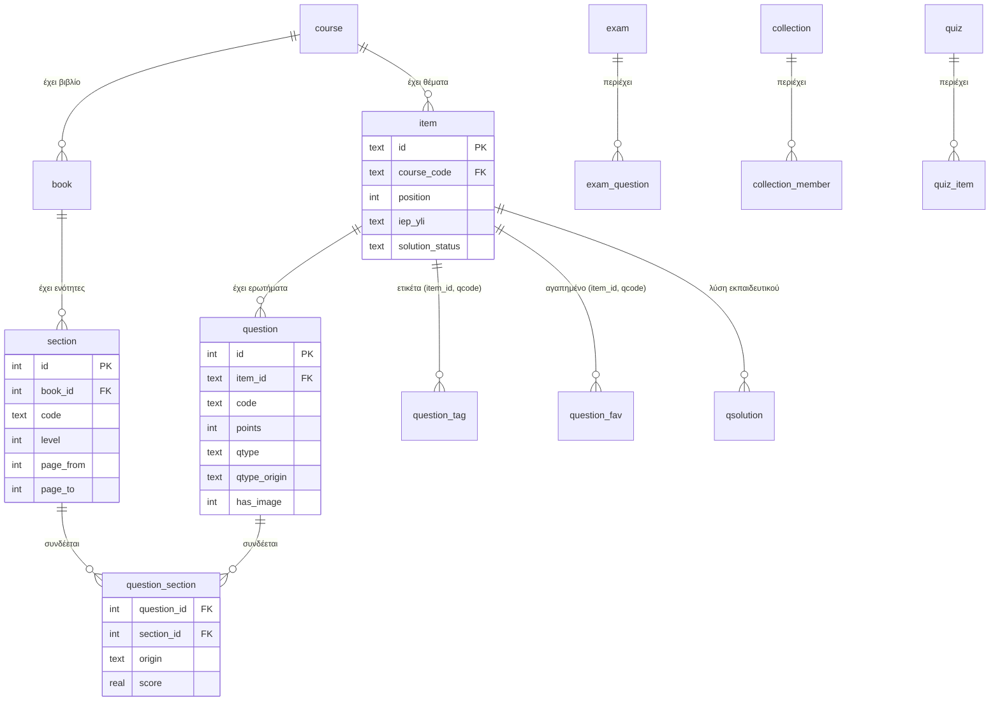
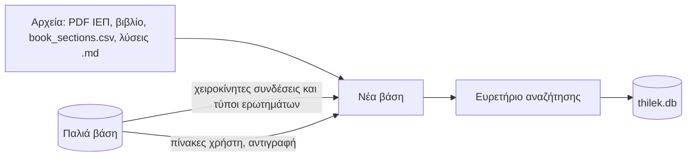

# TH-ILEK — Εγχειρίδιο βάσης δεδομένων

Η βάση είναι ένα αρχείο **SQLite** (`thilek.db`, διαδρομή στο `THILEK_DB`/`config`). Εδώ βλέπεις **ποιοι πίνακες υπάρχουν, τι πεδία έχουν, ποιες ενέργειες της εφαρμογής τα γράφουν ή τα διαβάζουν** και ποια δεδομένα **επιβιώνουν** όταν τρέξεις `thilek-rebuild`.

!!! note "Η βάση δεν είναι η πηγή αλήθειας για την τράπεζα"
    Τα θέματα, τα ερωτήματα, οι ενότητες και οι λύσεις εκπαιδευτικού **ξαναχτίζονται από τα αρχεία** (PDF ΙΕΠ, `book_sections.csv`, `.md` λύσεων). Στη βάση ζουν μόνο όσα φτιάχνεις εσύ (διαγωνίσματα, quiz, ετικέτες, έγγραφα…) και τα αντιγράφει το rebuild.

## 1. Οι τρεις κατηγορίες πινάκων

| Κατηγορία | Τι είναι | Στο rebuild |
|---|---|---|
| {{ok:Τράπεζα}} | `course`, `book`, `section`, `item`, `question`, `question_section(origin=iep/auto)`, `yli_year` | **ξαναχτίζονται** από τα αρχεία |
| {{info:Ευρετήρια}} | `qsolution`, `wordsrc`, `book_page`, `book_fts`, `q_fts` | **ξαναχτίζονται** (αντίγραφα αρχείων) |
| {{warn:Δεδομένα χρήστη}} | `exam`, `exam_question`, `question_tag`, `question_fav`, `collection`, `collection_member`, `quiz`, `quiz_item`, `mdoc`, `toolbox`, `trash`, `fileops`, `setting`, `wizard_recipe`, `iepcmp`, `ownitem` | **αντιγράφονται** όπως είναι |

Επιπλέον, μέσα στην Τράπεζα **διατηρούνται** οι δικές σου διορθώσεις: οι συνδέσεις `question_section` με `origin` manual/ai/rejected και ο τύπος/εικόνα ερωτήματος με `*_origin = manual`.

## 2. Διάγραμμα ER (σχέσεις)

!!! tip "Γιατί οι πίνακες χρήστη δεν έχουν ξένο κλειδί προς το `question`"
    Το `question.id` αλλάζει σε κάθε rebuild. Γι' αυτό διαγωνίσματα, ετικέτες, αγαπημένα, συλλογές και quiz αναφέρονται με το ζεύγος **(`item_id`, `qcode`)**, που μένει σταθερό, και επιβιώνουν.

## 3. Πίνακες και πεδία

=== "Τράπεζα"
    **`course`** — μάθημα. `code` (PK, π.χ. `B-ILEKTROTECHNIA`), `title_el`, `grade`, `exam_type` (TTDD | PAN).
    Γράφεται από: rebuild. Διαβάζεται από: σχεδόν όλες τις σελίδες.

    **`book`** — σχολικό βιβλίο. `id`, `course_code`, `title_el`, `relpath` (PDF στον φάκελο δεδομένων), `pdf_offset` (σελίδα PDF = τυπωμένη + offset).
    Γράφεται από: rebuild. Διαβάζεται από: Θέματα (πάνελ βιβλίου), Συγχώνευση PDF, Αναζήτηση.

    **`section`** — ενότητα/υποενότητα βιβλίου. `id`, `book_id`, `code` (π.χ. `4.1.2`), `level` (2 ενότητα, 3 υποενότητα), `title_el`, `page_from`, `page_to`, `note`.
    Γράφεται από: rebuild (από `03_YLI/book_sections.csv`). Διαβάζεται από: έλεγχος συνδέσεων, Ύλη/σελίδα.

    **`item`** — θέμα ΙΕΠ. `id` (π.χ. `17698`), `course_code`, `source` (TTDD|PAN|OWN|COLL), `position` (Θέμα 2 ή 4), `iep_date`, `iep_yli` (ύλη ΙΕΠ), `iep_chapter`, `is_public`, `statement_path`, `solution_path`, `solution_status`, `sha_statement`, `sha_solution`.
    Γράφεται από: rebuild. Διαβάζεται από: Θέματα, Ερωτήματα.

    **`question`** — υποερώτημα. `id`, `item_id`, `code` (2.1…), `points`, `text`, `kind`, `qtype` (mcq|true_false|matching|fill|problem|development), `qtype_origin` (auto|manual), `has_image`, `image_origin`, `geo`/`sol_geo` (JSON περιοχές στο PDF), `sol_text`.
    Γράφεται από: rebuild· **οι αλλαγές τύπου/εικόνας** από το `/review/{id}/meta`. Διαβάζεται από: σχεδόν όλα.

    **`question_section`** — σύνδεση ερωτήματος–υποενότητας. `question_id`, `section_id`, `origin` (iep|auto|manual|ai|rejected), `score`.
    Γράφεται από: rebuild (iep, auto)· **επιβεβαίωση/προσθήκη/αφαίρεση** από το `/review/{id}/link`.

    **`yli_year`** — προορίζεται για «ύλη ανά σχολικό έτος». {{warn:Δεν χρησιμοποιείται ακόμη}} από καμία σελίδα.

=== "Δεδομένα χρήστη"
    **`exam`** — διαγώνισμα: `id`, `title`, `subtitle`, `school`, `class_name`, `exam_date`, `duration`, `notes`, `created`. **`exam_question`** — `exam_id`, `grp` (Θέμα Α–Θ), `pos`, `item_id`, `qcode`. Γράφονται από `/exams…`.

    **`question_tag`** — `item_id`, `qcode`, `tag`. Γράφεται από τη φόρμα ετικέτας στα Θέματα, τη μπάρα ενεργειών και το `/tags`.

    **`question_fav`** — `item_id`, `qcode`, `added`. Γράφεται από το αστέρι (`/fav/{id}`).

    **`collection`** — `id`, `name`, `kind`, `note`, `criteria` (JSON φίλτρων), `options` (JSON), `created`, `saved_file` (σχετική διαδρομή αρχείου στο `07_EXAGOGES`). **`collection_member`** — `collection_id`, `pos`, `item_id`, `qcode` (NULL = ολόκληρο το θέμα). Γράφονται από τη μπάρα ενεργειών και το `/collections/…`.

    **`quiz`** — `id`, `name`, `description`, `created`. **`quiz_item`** — `id`, `quiz_id`, `pos`, `kind` (tf|mcq|free), `stem`, `options` (JSON), `answer`, `points`, `feedback`, `src_item`, `src_qcode`, `src_part`, `use_image`, `status` (ok|review). Γράφονται από `/quizzes…` και την επιλογή ερωτημάτων.

    **`mdoc`** — έγγραφο Markdown: `id`, `name`, `markdown`, `source`, `created`, `updated`. Γράφεται από `/docs…` και από την επαναφορά από τον κάδο. {{info:Το έγγραφο ζει μόνο εδώ}}, όχι ως αρχείο, μέχρι το «Αντίγραφο στον server».

    **`toolbox`** — `slot` (1–3), `name`, `items` (JSON), `enabled`. Γράφεται από `/toolbox/save`.

    **`trash`** — `id`, `orig_rel`, `trash_rel`, `kind`, `size`, `deleted`, `reason`. **`fileops`** — `id`, `ts`, `op`, `path`, `detail`. Γράφονται από τον file browser και τη διαγραφή εγγράφων.

    **`setting`** — `k`, `v`. Γράφεται από το `/settings` (`diagram_mode`, `help_default`, `help_show`, `help_mode`, `start_page`, `tip_*`, `wiz_criteria`, `gform_images`, `drive_url`, `rclone_remote`).

    **`ownitem`** — `item_id`, `title`, `year`, `note` για θέματα με `item.source` = `OWN` (δικά μου) ή `PAN` (πανελλήνιες)· τα ίδια τα θέματα και ερωτήματα είναι στους πίνακες `item`/`question` και **μεταφέρονται** στο rebuild (τα θέματα ΙΕΠ ξαναχτίζονται από τα αρχεία).

    **`iepcmp`** — `item_id`, `qcode`, `qn` (στοιχείο quiz), `kind`, `mine`, `iep`, `auto` (αυτόματη κρίση), `status` (τελική κατάσταση), `manual` (1 = την άλλαξες εσύ), `note`, `updated`. Γράφεται από τη σελίδα Σύγκριση ΙΕΠ· οι χειροκίνητες κρίσεις διατηρούνται στο rebuild.

    **`wizard_recipe`** — `id`, `name`, `state` (JSON με όλη την κατάσταση των βημάτων του wizard), `created`, `updated`. Γράφεται από το `/wizard`· **επιβιώνει του rebuild**.

=== "Ευρετήρια"
    **`wordsrc`** — ό,τι διαβάστηκε από τα Word του ΙΕΠ (`<ID>.docx`, `<ID>_SOLUTION.docx`): `item_id`, `kind` (`statement`/`solution`), `relpath`, `sha`, `mtime`, `n_par`, `n_eq`, `n_img`, `n_q`, `pts`, `status` (`ok`/`warn`/`error`), `warn` (JSON), `text` (με εξισώσεις σε LaTeX), `images` (JSON). Γράφεται από το «Σάρωση αρχείων Word» και το rebuild· ξαναχτίζεται από τα αρχεία.

    **`qsolution`** — αντίγραφο των αρχείων λύσεων `.md`: `item_id`, `qcode`, `question_id`, `iep_id`, `sub`, `relpath`, `fm` (front matter, JSON), `sections`, `quiz`, `status`, `warn`, `mtime`, `sha`. Γράφεται από «Σάρωση φακέλου» (`/lyseis/scan`) και το rebuild.

    **`book_page`** — κείμενο κάθε σελίδας βιβλίου (`book_id`, `pdf_page`, `printed`, `text`, `norm`). **`book_fts`**, **`q_fts`** — πίνακες FTS5 αναζήτησης. Γράφονται από «Ανανέωση ευρετηρίου» (`/search/reindex`) και το rebuild.

=== "Σύστημα"
    **`schema_version`** — μία γραμμή με τον αριθμό έκδοσης σχήματος (τώρα **2**). Τα βήματα αναβάθμισης είναι στο `app/migrations.py` και τρέχουν αυτόματα στην εκκίνηση· δεν χρειάζεται rebuild. Κάθε νέος πίνακας χρήστη πρέπει να δηλώνεται και στο `app/schema.sql` και στη λίστα του `tools/rebuild.py`.

## 4. Τι γίνεται στο rebuild

!!! warning "Αν αλλάξει θέμα, ερώτημα ή ενότητα"
    Μια χειροκίνητη σύνδεση που αναφέρεται σε ενότητα ή ερώτημα που δεν υπάρχει πια **δεν μεταφέρεται**· το rebuild γράφει «ΠΡΟΣΟΧΗ: χάθηκαν Ν χειροκίνητες συνδέσεις».

## 5. Λίστα ελέγχου πριν από rebuild

- [ ] Πήρα αντίγραφο του αρχείου της βάσης (`THILEK_DB`) ή έχω πρόσφατο backup του CT.
- [ ] Τα νέα PDF ΙΕΠ είναι στο `04_TRAPEZA/orig` με τα σωστά ονόματα.
- [ ] Τα νέα αρχεία λύσεων `.md` έχουν όνομα `<ID>.<θέμα>-<υπ>.md`.
- [ ] Μετά το rebuild έλεγξα την προειδοποίηση για χαμένες συνδέσεις και το `solution_warnings.txt`.

!!! danger "Μην επεξεργάζεσαι το `.db` ενώ τρέχει η εφαρμογή"
    Ο file browser μπλοκάρει αλλαγές στα `*.db`. Αν χρειάζεται χειροκίνητη επέμβαση, σταμάτα πρώτα την υπηρεσία.
