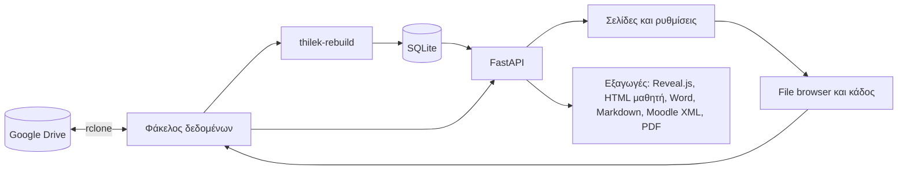
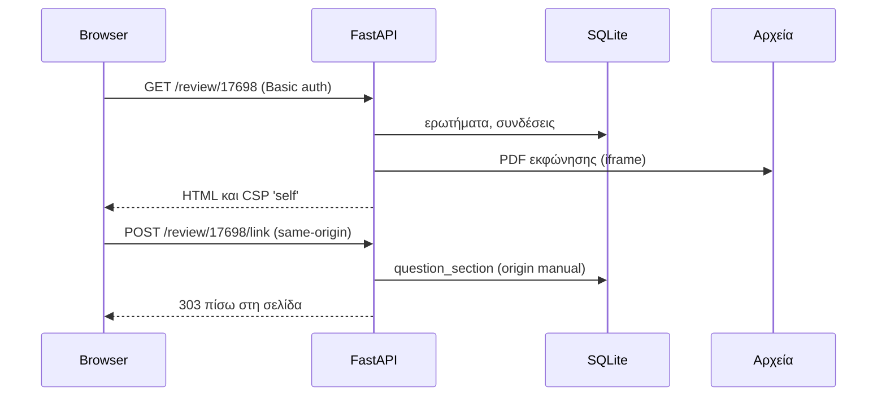

# TH-ILEK — Διάγραμμα λειτουργίας του συστήματος

Πώς φτάνει ένα αρχείο από το Google Drive μέχρι την εξαγωγή που δίνεις στους μαθητές.

## 1. Συνολική εικόνα

!!! info "Πού τρέχει"
    Ο server τρέχει στο Proxmox LXC **CT 115** (`192.168.1.59:8010`), μόνο στο σχολικό δίκτυο, με Basic auth και έναν χρήστη.

## 2. Ροή δεδομένων

=== "Είσοδος"
    - **Αρχεία ΙΕΠ και βιβλίου** (`04_TRAPEZA/orig`, `02_VIVLIA`, `03_YLI`): έρχονται από το Drive και δεν τροποποιούνται από την εφαρμογή.
    - **Λύσεις εκπαιδευτικού** (`orig/<ID>.<θέμα>-<υπ>.md`): τα γράφεις εκτός εφαρμογής.
    - **Σάρωση φακέλου** ή **rebuild** τα περνά στη βάση.

=== "Επεξεργασία"
    - `thilek-rebuild` διαβάζει PDF και ευρετήριο, χτίζει θέματα, ερωτήματα, ενότητες και προτάσεις συνδέσεων, ξαναδιαβάζει τις λύσεις και χτίζει το ευρετήριο αναζήτησης.
    - Οι δικές σου διορθώσεις και οι πίνακες χρήστη αντιγράφονται στη νέα βάση.

=== "Έξοδος"
    - Σελίδες HTML από τον server, με τοπικά στατικά αρχεία (KaTeX, Reveal.js, Mermaid)· **καμία CDN**.
    - Εξαγωγές που κατεβάζεις, ή που αποθηκεύονται στο `07_EXAGOGES`.

## 3. Αίτημα στην εφαρμογή

## 4. Ασφάλεια και όρια

!!! warning "Τι δεν κάνει το σύστημα"
    Δεν έχει HTTPS, δεν έχει πολλούς χρήστες και δεν είναι προσβάσιμο από το internet. Κάθε POST ελέγχεται ότι έρχεται από το ίδιο origin, και η CSP επιτρέπει μόνο αρχεία του ίδιου server.

- [ ] Δεν διανέμω δημόσια υλικό ΙΕΠ ή βιβλίων.
- [ ] Οι εξαγωγές μαθητή δεν περιέχουν απαντήσεις που δεν θέλω.
- [ ] Έλεγξα την εξαγωγή πριν τη δώσω (δεν έχει δοκιμαστεί σε πραγματικό Moodle/Word).
